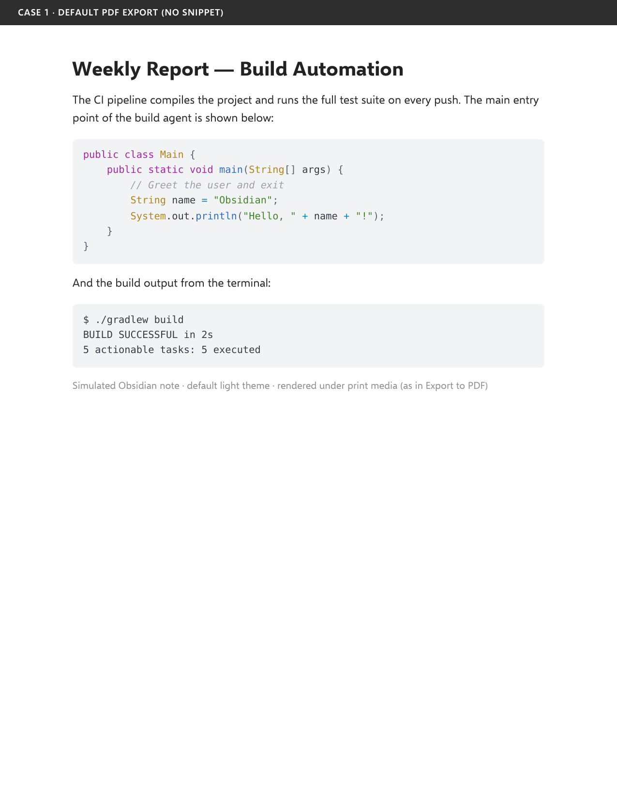
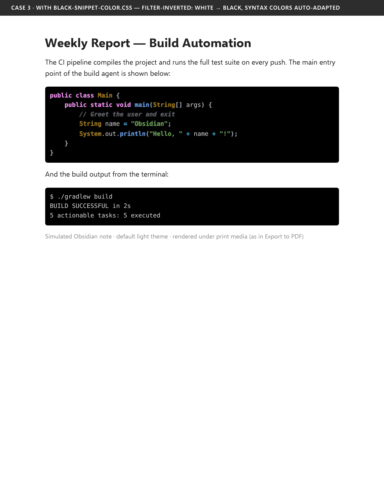

# Black Code Blocks for Obsidian PDF Export

An Obsidian plugin that makes exported code blocks render as clean, black, terminal-style blocks with adaptive syntax colors and improved contrast. The plugin only changes print/PDF output; the editor and reading view are unchanged.

The repository also includes the standalone `black-snippet-color.css` snippet for users who prefer managing snippets manually.

> The styling lives inside `@media print`, so it **only affects the exported PDF (and physical printing)**. Your editor and reading view look exactly the same as before — that is by design.

---

## Plugin installation

1. Download the latest release assets: `main.js`, `manifest.json`, and `styles.css`.
2. Create `<your-vault>/.obsidian/plugins/black-snippet/`.
3. Copy those three files into that folder.
4. Restart Obsidian, then enable **Black Code Blocks** under **Settings → Community plugins**.

The plugin's release version must match the `version` in `manifest.json`.

### Manifest validation

GitHub Actions validates `manifest.json` against `.github/manifest.schema.json` on every
push and whenever a pull request is opened, updated, or reopened. The workflow checks
both JSON syntax and the required Obsidian manifest fields.

## Standalone snippets

| File | How it works | Best for |
|------|--------------|----------|
| **`black-snippet-color.css`** | CSS filter trick: `invert(100%)` + `hue-rotate(180deg)` flips the whole block white → black, then rotates hues back so syntax colors stay natural. Also fixes the "white highlight" double-inversion bug and bolds tokens for extra contrast. | Default/light themes — the colors adapt to the black background automatically |

Enable `black-snippet-color.css` in Obsidian's CSS snippets settings if you are not using the plugin.

---

## Proof — what they do to an exported PDF

Rendered from a simulated Obsidian note (default light theme) under print media — the same rendering path Obsidian's *Export to PDF* uses.

**1. Default export, no snippet — the problem: washed-out light-gray blocks**

**2. With `black-snippet-color.css` — block inverted white → black, syntax colors auto-adapted**

---

### Installation (Obsidian desktop)

1. Open Obsidian and go to **Settings → Appearance**.
2. Scroll down to the **CSS snippets** section.
3. Click the **folder icon** next to "CSS snippets" — this opens `<your-vault>/.obsidian/snippets/`.
4. Copy **`black-snippet-color.css`** into that folder.
5. Back in **Settings → Appearance**, click the **refresh icon** next to "CSS snippets" — the file name(s) appear in the snippet list.
6. Toggle the snippet **ON**.

The plugin uses the same styling as `black-snippet-color.css`.

## Exporting the PDF

1. Open the note you want to export.
2. Open the **File menu → Export to PDF** (or run **"Export to PDF"** from the command palette).
3. The code blocks come out black with adapted syntax colors — no other settings needed.

---

## Troubleshooting

| Symptom | Fix |
|---------|-----|
| Code blocks are still light gray | Make sure the plugin is enabled, or the snippet is toggled **ON** in Settings → Appearance, and that you used **Export to PDF** — on screen nothing changes by design |
| The new snippet doesn't appear in the list | Click the **refresh icon** next to "CSS snippets", or restart Obsidian |
| Colors look wrong or double-applied | Disable either the plugin or the standalone snippet; do not enable both at the same time |
